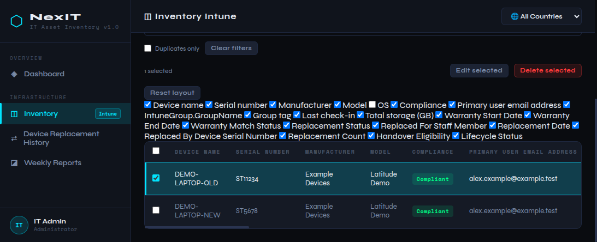
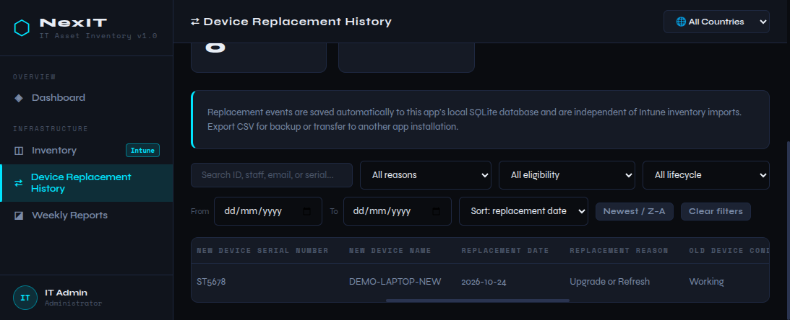

# All-in-One IT Hub

A local IT asset inventory and operations dashboard built with HTML, CSS, vanilla JavaScript, Python's standard library, and SQLite. It supports Intune-style inventory CSV import, warranty matching, replacement history, device management, filtering, analytics, and CSV exports.

> **Local-use application:** The server listens on `127.0.0.1` and SQLite is designed for one local app instance/user at a time. This is not a hosted, multi-user service. Do not expose it to the internet or a shared network without adding authentication, authorization, and an appropriate shared database/API.

## Requirements

- Python 3.10 or newer (Python 3.12 recommended)
- A current web browser
- Internet access for the externally hosted Chart.js dashboard charts; the rest of the app runs locally
- No pip packages, Node.js, or separate database server are required

The app uses Python's built-in `http.server` and `sqlite3` modules.

## Quick start

### Linux

1. Install Python 3.10 or newer if it is not already installed.
2. Open a terminal in the folder containing `server.py` and `index.html`.
3. Start the app:

   ```sh
   python3 server.py
   ```

   Or run `sh start-linux.sh`.

4. Open [http://localhost:8000](http://localhost:8000).
5. Keep the terminal open while using the app. Press `Ctrl+C` in that terminal to stop it.

### Windows

1. Install Python 3.10 or newer if it is not already installed.
2. Open the project folder in File Explorer, enter `powershell` in the address bar, and press Enter.
3. Start the app:

   ```powershell
   py server.py
   ```

   If `py` is unavailable, try `python server.py` or double-click `start-windows.bat`.

4. Open [http://localhost:8000](http://localhost:8000).
5. Keep the terminal open while using the app. Press `Ctrl+C` there to stop it.

Do not use `python -m http.server` as the normal startup method; the app needs its own SQLite API as well as static file serving. If port 8000 is already in use, stop the other app using that port before starting this one.

## First run and local data

The server automatically creates `nexit-assets.db` in the operating system's local application-data directory. On first startup, if the database is empty, the app can copy legacy `nexit_inventory` and `nexit_warranty` browser data into SQLite. The original browser values are not deleted.

Database location:

- Linux: `$XDG_DATA_HOME/NexIT-Asset-Inventory/nexit-assets.db`, or `~/.local/share/NexIT-Asset-Inventory/nexit-assets.db`
- Windows: `%LOCALAPPDATA%\NexIT-Asset-Inventory\nexit-assets.db`
- macOS: `~/Library/Application Support/NexIT-Asset-Inventory/nexit-assets.db`

The server prints the active database path when it starts. You can also check `http://localhost:8000/api/health`.

The project intentionally does not include device, warranty, or replacement records. Import your own files after starting the app. The `.gitignore` excludes the `data/` folder, CSV/Excel files, local databases, Python virtual environments, and generated caches to help prevent accidental publication of operational data.

## How to use the app

### Dashboard

Open **Dashboard** to view inventory metrics, filters, and charts. Use the available country, department, OS, status, lifecycle, warranty, planned-action, and model filters. Selecting a KPI opens the matching inventory records. Use **Refresh** to reload analytics and **Clear filters** to reset the dashboard filters.

### Inventory

1. Open **Inventory**.
2. Select **Import CSV** and choose an Intune device export. The required columns are `Device ID`, `Device name`, and `Serial number`.
3. If the import finds serial duplicates, choose whether to merge them with existing records or keep them separately. Kept duplicates are given a suffix and highlighted.
4. Use the universal search box to search across all device fields — device name, user, serial, group, warranty, status, and more. The **Duplicates only** checkbox filters to duplicated serials. Visible-column checkboxes appear in one horizontal row; use **More columns** to enable hidden columns, or **Reset layout** to restore the defaults.
5. Select a device checkbox to highlight its entire row. Use **Select all visible**, **Edit selected**, or **Delete selected** for bulk actions.
6. Use **+ Add device**, **Edit**, or **Delete** to manage individual records. Inventory changes are saved to SQLite. **Undo** and **Redo** are available for recent inventory changes in the current page session.
7. Select **Export CSV** to download the inventory currently shown by the active search or filters.

The inventory supports Laptop, Firewall, UPS, AccessPoint, and Switch device types in the same SQLite database. Use the device-type links below **Inventory** to filter the list; a link is shown only while at least one device of that type exists. Use **Inventory** to see all types. Existing records without an asset type remain laptops. Use **+ Add device** to choose a type and enter common details such as serial number, manufacturer, model, and location, plus network or UPS fields where relevant. CSV imports can include an `Asset type` column, or a `Device type` column containing one of the supported categories; without one they are treated as the currently selected type, or Laptop when viewing all inventory.

**Fixed Asset Number** is optional. Enter the Finance/SAP book asset number when known. Hover over the column heading or field label for guidance; if the number is unavailable, check with the Finance asset manager. The value is retained in SQLite and included in inventory CSV imports and exports.

**Active device status** and **Age** are computed columns. A device is shown as **Inactive** when its last check-in is more than 90 days old, otherwise **Active**. **Age** shows the warranty span in the format `5y 1m` (derived from the warranty start and end dates).

The inventory table keeps the header, search box, and checkbox column visible while you scroll, so the displayed columns and records remain easy to track.

Replacement fields shown in the table are derived from the separate replacement history and are not written into the source inventory records or inventory CSV export.

### Warranty matching

1. In **Inventory**, select **Import Warranty**.
2. Choose a CSV with a `Serial number` column. `Warranty Start Date` and `Warranty End Date` are optional.
3. The app matches serial numbers without case or whitespace differences and shows the warranty match status in the inventory.

### Device Replacement History

Replacement history tracks an old device being replaced by a new one while keeping both device records distinct.

1. Open **Device Replacement History**.
2. Add a record manually with **+ Add replacement**, or import an existing history CSV.
3. For old and new devices, use the combined input to select an inventory suggestion or enter a serial number manually. Missing inventory matches are allowed and clearly indicated.
4. Enter the staff, date, reason, old-device condition, handover decision, lifecycle status, and optional remarks. The app warns about a previously replaced old serial or a repeated old/new serial pair.
5. View, edit, or delete records from the history table. CSV import offers **Merge** (add new IDs without overwriting existing records) or **Replace** (replace the loaded history after confirmation).
6. Records are saved automatically in SQLite. Use **Export Replacement History CSV** for a backup or to transfer history. **Download Empty Template** creates a CSV with the expected headers.

The Inventory view derives replacement status, replaced-for staff, replacement date, replacement device serial, replacement count, handover eligibility, and lifecycle status by matching old-device serial numbers. For multiple events on one old serial, history is retained, dates and replacement serials are shown, and the latest event supplies the single current eligibility and lifecycle values. A missing device in a newer Intune import does not delete its replacement event.

If you used an earlier CSV-only version of the app, import your existing replacement-history CSV once after upgrading. The imported data will then be stored in SQLite.

## Screenshots

The screenshots below use synthetic example records only; they do not contain operational inventory or staff data.

### Inventory

The inventory table supports row selection, filtering, configurable columns, and replacement-derived status fields. The selected example row is highlighted across the visible columns.



### Device Replacement History

Replacement events can be reviewed and filtered in a separate history table. The table scrolls horizontally to show additional device and lifecycle fields.



## CSV formats

### Inventory CSV

Required headers:

- `Device name`
- `Serial number`

`Device ID`, `Asset type`, and `Fixed Asset Number` are optional. Add an optional `Asset type` column (recommended) or a `Device type` column containing one of `Laptop`, `Firewall`, `UPS`, `AccessPoint`, or `Switch` to classify each imported record. Other columns, including `Fixed Asset Number`, are retained where provided. The app derives `Total storage (GB)` from raw `Total storage` when available.

After import, a report lists the recognized columns (which were updated, shown in green) and any unrecognized columns (shown in red). The report stays open until you close it.

### Warranty CSV

Required header: `Serial number`.

Optional headers: `Warranty Start Date`, `Warranty End Date`.

### Replacement history CSV

The replacement CSV contains only replacement-event fields, not a copy of the inventory:

1. Replacement ID
2. Staff Member Name
3. Staff Email
4. Old Device Serial Number
5. New Device Serial Number
6. Replacement Date
7. Replacement Reason
8. Old Device Condition
9. Handover Eligibility
10. Lifecycle Status
11. Remarks

The app validates these fields during import and supports commas, quotes, and newlines in remarks. CSV import/export is for backup and transfer; SQLite is the app's working store.

## Backup and restore

Inventory, warranty, and replacement history are stored in the SQLite database outside the project folder. To back it up directly:

1. Stop the app with `Ctrl+C`.
2. Copy `nexit-assets.db` from the database location listed above to secure backup storage.
3. Restart the app.

To restore, stop the app and replace the database file with a trusted backup, then restart. Keep backups protected because they contain device and staff information. You can also export inventory and replacement history as separate CSV backups from their respective sections.

## Run tests

From the project folder:

```sh
python3 -m unittest -v
```

On Windows, use:

```powershell
py -m unittest -v
```

The tests use temporary SQLite databases and do not need your local inventory data.

## Project files

- `index.html` — page structure, navigation, and script loading
- `main.css` — shared styling and responsive layouts
- `app.js` — module navigation, SQLite-backed storage, and shared UI helpers
- `dashboard.js`, `dashboard_metrics.py` — dashboard UI and calculations
- `inventory.js` — inventory, CSV import/export, warranty matching, and device actions
- `replacement-history.js` — replacement history UI, validation, matching, and CSV transfer
- `server.py` — local HTTP server and SQLite API
- `test_server.py`, `test_dashboard_metrics.py` — automated tests
- `start-linux.sh`, `start-windows.bat` — convenience launchers

## Security and deployment notes

- The app has no sign-in, user roles, multi-user synchronization, or audit log.
- The local server binds to `127.0.0.1`. Do not change this or expose the server to a shared network without first implementing appropriate access controls and a production server/database design.
- Keep the SQLite database, exports, and Intune source files private. Never commit real user, device, warranty, or replacement data to a public repository.
- There is no automatic off-device backup. Establish a regular, tested backup and restore process.
- GitHub Pages cannot run this app by itself because inventory and replacement changes require the Python/SQLite API.
- Chart.js is loaded from jsDelivr, so dashboard charts need internet access.
